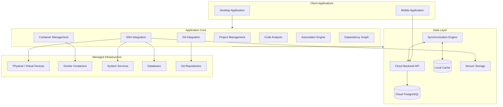

# Vaurenith

**Unified Development & Infrastructure Management Environment**

Vaurenith — персональная среда управления разработкой, объединяющая Git-репозитории, исходный код, физические и виртуальные устройства, удалённые серверы и развёрнутые на них сервисы в едином рабочем пространстве.

Основная идея проекта — предоставить разработчику централизованный инструмент для управления собственными проектами и инфраструктурой, визуализации архитектуры программного обеспечения и отслеживания взаимосвязей между исходным кодом и работающими компонентами.

---

## Содержание

- [Основная концепция](#основная-концепция)
- [Ключевые возможности](#ключевые-возможности)
- [Архитектура продукта](#архитектура-продукта)
- [Основные компоненты](#основные-компоненты)
- [Связь кода и инфраструктуры](#связь-кода-и-инфраструктуры)
- [Безопасность](#безопасность)
- [Автономная работа и синхронизация](#автономная-работа-и-синхронизация)
- [Технологический стек](#технологический-стек)
- [План развития](#план-развития)
- [Ограничения проекта](#ограничения-проекта)
- [Документация](#документация)
- [Лицензия](#лицензия)

---

## Основная концепция

При работе над несколькими программными проектами разработчику приходится использовать множество независимых инструментов:

- SSH-клиенты для подключения к удалённым серверам;
- Git-клиенты для управления репозиториями;
- Docker-инструменты для работы с контейнерами;
- средства мониторинга системных ресурсов;
- клиенты баз данных;
- терминалы и собственные скрипты автоматизации;
- инструменты анализа архитектуры исходного кода.

Vaurenith объединяет взаимодействие с этими инструментами в одном интерфейсе, сохраняя их специализированную функциональность.

В основе системы лежит единая модель данных, связывающая программные проекты, репозитории, компоненты исходного кода, окружения, устройства и развёрнутые сервисы.

### Основные принципы

- **Project-centric architecture** — проект является центральной сущностью системы.
- **Unified workspace** — единое рабочее пространство для разработки и администрирования.
- **Infrastructure visibility** — наглядное представление состояния инфраструктуры.
- **Code-to-infrastructure mapping** — связь исходного кода с работающими приложениями и сервисами.
- **Automation first** — сокращение повторяющихся ручных операций.
- **Local-first capabilities** — доступность локальных функций без обязательного подключения к интернету.
- **Security by design** — безопасная работа с удалёнными устройствами и конфиденциальными данными.
- **Modular architecture** — возможность расширения системы без переработки её ядра.

## Ключевые возможности

### Управление проектами

Централизованное управление программными проектами и связанными с ними ресурсами.

- Создание, редактирование, архивирование и удаление проектов.
- Привязка нескольких Git-репозиториев.
- Объединение локальных и удалённых окружений.
- Привязка серверов, контейнеров, служб и баз данных.
- Хранение пользовательских команд и сценариев.
- Просмотр сводной информации о проекте и последних событиях.

### Управление устройствами и SSH

Управление физическими и виртуальными устройствами, доступными в локальной сети или через публичные адреса.

- Подключение по IP-адресу или доменному имени.
- SSH-аутентификация с использованием ключей и паролей.
- Поддержка нескольких подключений к одному устройству.
- Одновременная работа с несколькими SSH-сессиями.
- Проверка доступности устройств.
- Отображение операционной системы и системных ресурсов.
- Восстановление соединения после разрыва.
- Проверка SSH host keys.

### Терминал и автоматизация

Интегрированная среда выполнения локальных и удалённых команд.

- Интерактивная SSH-консоль.
- Несколько независимых терминальных сессий.
- История выполненных команд.
- Библиотека пользовательских команд и скриптов.
- Параметризованные сценарии.
- Выполнение сценариев на выбранных устройствах.
- Отображение результатов, ошибок и прогресса выполнения.
- Подтверждение потенциально опасных операций.

### Управление инфраструктурой

Наблюдение за состоянием серверов и развёрнутых на них компонентов.

- Просмотр системных служб и управление ими.
- Поддержка systemd.
- Мониторинг CPU, RAM и дискового пространства.
- Просмотр системных логов.
- Управление Docker-контейнерами.
- Просмотр образов, портов, томов и сетей.
- Запуск, остановка и перезапуск контейнеров.
- Просмотр логов контейнеров в реальном времени.
- Обнаружение и учёт баз данных.
- Поддержка PostgreSQL.

### Управление Git-репозиториями

Инструменты контроля версий непосредственно в рабочем пространстве проекта.

- Просмотр состояния репозитория и рабочей директории.
- Работа с локальными и удалёнными ветками.
- История коммитов.
- Просмотр изменений между коммитами и ветками.
- Анализ изменений отдельных файлов.
- Просмотр diff.
- Основные Git-операции: fetch, pull, push, commit, checkout.
- Создание и переключение веток.
- Отображение конфликтов и ошибок операций.
- Переход к репозиторию во внешней IDE или файловом менеджере.

### Анализ архитектуры исходного кода

Интерактивное представление структуры программного обеспечения.

- Построение графа файлов, модулей и пакетов.
- Визуализация направленных зависимостей.
- Поиск файлов, модулей и символов.
- Фильтрация графа по типам узлов и связей.
- Обнаружение циклических зависимостей.
- Выявление компонентов с большим количеством связей.
- Сравнение архитектуры между коммитами.
- Выделение компонентов, затронутых изменениями.
- Переход от элементов графа к исходному коду.
- Исключение каталогов сборки и внешних зависимостей.

### История событий

Единая хронология действий и изменений, связанных с проектами и инфраструктурой.

- История выполнения пользовательских сценариев.
- Регистрация доступных Git-операций.
- Фиксация изменений состояния служб и контейнеров.
- Результаты проверок доступности устройств.
- События развёртывания при наличии соответствующих источников.
- Фильтрация по проектам, устройствам, типам событий и времени.

---

## Архитектура продукта

Vaurenith проектируется как модульная система с разделением пользовательского интерфейса, бизнес-логики, доступа к данным и интеграций с внешними инструментами.

Основной принцип архитектуры — независимость бизнес-логики от конкретных реализаций интерфейса и инфраструктурных интеграций.

### Концептуальная схема



### Модель хранения данных

Система предусматривает два уровня хранения.

**Облачное хранилище**

Облачная PostgreSQL выступает основным источником достоверных пользовательских данных.

В ней хранятся:

- проекты и их метаданные;
- сведения об устройствах;
- репозитории и связи между сущностями;
- пользовательские сценарии;
- общие настройки;
- история изменений и событий;
- информация о зарегистрированных клиентских устройствах.

**Локальное хранилище**

Локальная база данных используется для кэширования и автономной работы.

В ней хранятся:

- кэш облачных метаданных;
- локальные пути к репозиториям;
- клиентские настройки;
- состояние синхронизации;
- локальная история операций;
- данные, необходимые для автономной работы.

Пароли, закрытые SSH-ключи и токены доступа хранятся исключительно в защищённом хранилище соответствующего устройства.

---

## Основные компоненты

| Компонент | Назначение |
|---|---|
| Project Manager | Управление проектами и связанными ресурсами |
| Device Manager | Управление физическими и виртуальными устройствами |
| SSH Manager | Создание и управление SSH-подключениями |
| Terminal | Интерактивная работа с командной оболочкой |
| Script Engine | Выполнение пользовательских сценариев |
| Git Manager | Работа с Git-репозиториями |
| Container Manager | Управление Docker-контейнерами |
| Service Monitor | Мониторинг служб и системных ресурсов |
| Database Manager | Учёт и обнаружение баз данных |
| Code Analyzer | Анализ структуры исходного кода |
| Dependency Graph | Визуализация архитектуры и зависимостей |
| Event Manager | Регистрация и отображение событий |
| Sync Engine | Синхронизация данных между клиентами |

---

## Связь кода и инфраструктуры

Ключевой отличительной особенностью Vaurenith является возможность объединять программную архитектуру и физическую инфраструктуру в единую модель.

Например, приложение может содержать несколько репозиториев, каждый из которых связан с отдельным сервисом. Сервисы могут работать в Docker-контейнерах, размещённых на различных удалённых устройствах.

В Vaurenith предполагается возможность проследить всю эту цепочку:

```text
Project
  |
  +-- Repository
  |     |
  |     +-- Module
  |     |     |
  |     |     +-- Component
  |     |
  |     +-- Dependencies
  |
  +-- Environment
        |
        +-- Device
              |
              +-- Docker Container
              |      |
              |      +-- Application Service
              |             |
              |             +-- Database
              |
              +-- System Services
```

Это позволяет:

- определять, на каких устройствах развёрнуты компоненты проекта;
- переходить от исходного кода к соответствующему сервису;
- просматривать состояние контейнеров и служб;
- исследовать зависимости между программными компонентами;
- понимать, какие части системы затронуты изменениями исходного кода.

Система должна различать автоматически обнаруженные и заданные пользователем связи, указывая источник и время последнего обновления информации.

---

## Безопасность

Безопасность является одним из основных требований проекта, поскольку Vaurenith взаимодействует с удалёнными устройствами и потенциально привилегированными операциями.

Основные принципы:

- Хранение секретов в системном Secure Storage.
- Использование защищённых протоколов передачи данных.
- Проверка SSH host keys.
- Предупреждение при неожиданном изменении ключа сервера.
- Принцип минимально необходимых привилегий.
- Подтверждение потенциально опасных операций.
- Исключение секретов из логов, истории команд и экспортируемых конфигураций.
- Авторизация для доступа к облачным данным.
- Разграничение доступа между клиентскими устройствами.
- Защита от инъекций при формировании команд.

Облачный backend не должен предоставлять произвольный SSH-доступ к инфраструктуре через публичный сервер.

---

## Автономная работа и синхронизация

Vaurenith предусматривает возможность работы без постоянного подключения к интернету.

Локальные операции с репозиториями и устройствами, доступными по локальной сети, должны оставаться доступными независимо от состояния облачного соединения.

### Принцип синхронизации

- Облачное хранилище является источником истины для общих пользовательских данных.
- Локальное хранилище используется как кэш.
- Изменения общих данных фиксируются в ChangeLog.
- Состояние синхронизации каждого клиента хранится в SyncState.
- Локальные пути к репозиториям привязываются к конкретному ClientDevice.
- При восстановлении соединения выполняется синхронизация накопленных изменений.
- Конфликты разрешаются с учётом версий записей, временных меток и журнала изменений.

Каждый экземпляр приложения регистрируется как отдельное клиентское устройство.

Мобильный клиент и облачная синхронизация позволяют в дальнейшем расширить рабочее пространство за пределы основного компьютера.

---

## Технологический стек

Технологический стек определяется по мере реализации соответствующих компонентов.

Основные архитектурные направления:

| Направление | Предусмотренная технология |
|---|---|
| Основная платформа первой версии | macOS |
| Облачная база данных | PostgreSQL |
| Удалённое управление | SSH |
| Контейнеризация | Docker |
| Контроль версий | Git |
| Управление службами Linux | systemd |
| Защищённое хранение секретов | System Secure Storage |
| Облачная синхронизация | Backend API + Sync Engine |
| Локальное хранение | Локальная база данных |
| Анализ исходного кода | Специализированные анализаторы |

Конкретные библиотеки, фреймворки, версии инструментов и параметры сборки будут зафиксированы в документации по мере формирования технической реализации.

---

## План развития

Разработка Vaurenith ориентирована на постепенное формирование единой среды управления проектами и инфраструктурой.

### Основные этапы

**Этап 1. Базовая инфраструктура приложения**

- Формирование архитектуры приложения.
- Реализация системы проектов.
- Локальное хранение данных.
- Управление устройствами.
- SSH-подключения и терминал.

**Этап 2. Управление инфраструктурой**

- Интеграция с Docker Engine.
- Управление контейнерами.
- Мониторинг системных служб.
- Получение системных метрик.
- Просмотр логов.

**Этап 3. Интеграция с Git**

- Управление репозиториями.
- История коммитов и веток.
- Просмотр изменений.
- Основные Git-операции.

**Этап 4. Анализ исходного кода**

- Разработка анализатора исходного кода.
- Построение графа зависимостей.
- Визуализация архитектуры.
- Сравнение изменений между версиями.

**Этап 5. Облачная инфраструктура**

- Разработка backend API.
- Облачная PostgreSQL.
- Авторизация пользователей.
- Синхронизация данных.
- ChangeLog и SyncState.
- Разрешение конфликтов.

**Этап 6. Расширение клиентской части**

- Разработка мобильного клиента.
- Уведомления о событиях.
- Просмотр состояния инфраструктуры.
- Выполнение заранее определённых безопасных операций.

*Порядок этапов является ориентиром развития и может корректироваться в зависимости от результатов разработки.*

---

## Ограничения проекта

Vaurenith не ставит целью полностью заменить специализированные инструменты разработки и администрирования.

В рамках первоначальной версии не предусматриваются:

- Полноценная замена IDE.
- Собственный Git-сервер.
- Реализация собственного SSH-протокола.
- Собственный движок контейнеризации.
- Полноценная CI/CD-платформа.
- Поддержка всех языков программирования и фреймворков.
- Полноценный графический SQL-редактор.
- Автоматическое обнаружение всех устройств локальной сети.
- Облачное выполнение произвольных команд с административными привилегиями.
- Автономное выполнение административных операций ИИ-агентами.

Vaurenith использует существующие инструменты и протоколы, объединяя их в единую систему взаимодействия.

---

## Документация

Дополнительная документация проекта будет содержать:

- описание архитектуры и модулей;
- описание модели данных;
- документацию backend API;
- инструкции по настройке SSH;
- описание интеграции с Docker;
- инструкции по сборке и запуску;
- руководство пользователя;
- документацию по безопасности;
- журнал изменений.

---

## Лицензия

Информация о лицензировании проекта будет добавлена после определения условий распространения.

---

<p align="center">
  <strong>Vaurenith</strong><br/>
  <sub>One workspace. Every project. Complete visibility.</sub>
</p>
